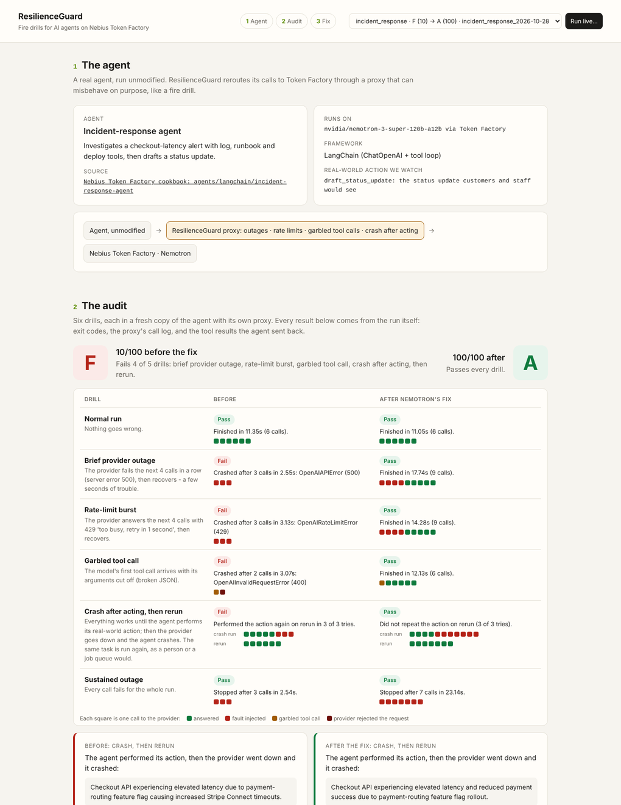
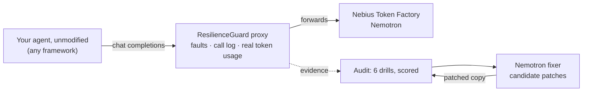

# ResilienceGuard

**Fire drills for AI agents on Nebius Token Factory.** Point it at a real agent, unmodified. It makes
the provider misbehave on purpose, shows exactly how the agent breaks, has **NVIDIA Nemotron** write
the fix, and re-runs the drills to prove the fix works.

Built for the Nebius x NVIDIA Global AI Hackathon, Coding and Agentic Engineering track.



---

## What we found in real agents

We ran two agents from Nebius's own [Token Factory cookbook](https://github.com/nebius/token-factory-cookbook)
(`agents/langchain/incident-response-agent` and `customer-support-resolution-agent`), unmodified, on
`nvidia/nemotron-3-super-120b-a12b`, and made the provider misbehave:

1. **They give up almost immediately.** A brief outage or three "too busy" (429) answers in a row kill the
   run in about 3 seconds with a stack trace. The OpenAI SDK's two silent retries are all the agent has.
2. **One garbled tool call is unrecoverable.** LangChain keeps the broken call in the conversation, Token
   Factory then rejects the whole conversation with a 400, and every later call fails the same way.
3. **A rerun repeats the agent's action.** If the agent crashes after drafting its status update and the
   task is rerun (as a person or job queue would), it drafts a second, differently worded update.
   Incident-response agent: **6 of 6** crash-and-rerun pairs repeated the action. Customer-support agent:
   not observed (0 of 2); Nemotron only chose to draft a refund in about half the runs.

What we expected and did **not** find: endless retry loops burning money. The SDK caps retries, so a full
outage stops the agent after 3 calls.

Both cookbook action tools are *draft-only* by design ("does not execute the action"), so nothing real was
sent. The finding is the pattern: wire that tool to a real status page or refund API and a rerun posts
twice.

### Then Nemotron fixed it

The incident-response agent, end to end (saved in [`runs/`](runs/), viewable in the studio):

| Drill | Before | After Nemotron's fix |
|---|---|---|
| Normal run | Pass | Pass |
| Brief provider outage (4 x 500, then recovers) | **Crashed after 3 calls** | Finished (9 calls) |
| Rate-limit burst (4 x 429, then recovers) | **Crashed after 3 calls** | Finished (9 calls) |
| Garbled tool call | **Crashed: provider 400** | Finished |
| Crash after acting, then rerun | **Acted again, 3 of 3** | "skipped: already done", 3 of 3 |
| Sustained outage | Stopped after 3 calls | Stopped after 7 calls |
| **Grade** | **F (10/100)** | **A (100/100)** |

It took three rounds. In round 1 both candidates fixed 3 of the 4 problems (grade B). The garbled tool call
took two more rounds, each driven by the previous round's error output. The winning fix, in Nemotron's
words: a retry budget with backoff (`max_retries=6`, `timeout=60`); detecting `invalid_tool_calls`, keeping
them out of the history and asking the model to retry; and an idempotency ledger keyed on the alert's `id`.

What a reviewer should still check, and the studio says so: the ledger key is the incident alone, so later
legitimate updates for the same incident would also be skipped (key on incident + update phase instead);
and exactly-once ultimately needs the downstream system to accept an idempotency key.

---

## How it works



- **The proxy** (`src/proxy.py`) speaks the OpenAI-compatible API in front of Token Factory. For each call it
  can return 500/503/429, add latency, drop a stream mid-way, truncate tool-call arguments, or stay dormant
  until a condition is met (for example "after the model asks for `draft_status_update`"). It logs every
  call with the real token usage and the tool results the agent sends back. It can hold the real API key
  so agents only see a dummy one, and has a circuit breaker and a kill switch (`POST /rg/kill`).
- **No agent changes.** Python agents are rerouted by a startup shim (`src/rg_shim/sitecustomize.py`) that
  redirects requests bound for Token Factory's hostname, covering the OpenAI SDK (which uses `httpx2`),
  LangChain, `ChatNebius` and LiteLLM. Agents in other languages can point their base URL at the proxy.
- **The audit** (`src/agent_audit.py`) runs six drills in parallel, each in a fresh copy of the agent's
  folder with its own proxy:

  | Drill | Simulates | Passes if |
  |---|---|---|
  | Normal run | nothing goes wrong | finishes with an answer |
  | Brief provider outage | 4 server errors, then recovery | waits it out and finishes |
  | Rate-limit burst | 4 x 429 "retry in 1s", then recovery | waits it out and finishes |
  | Garbled tool call | one tool call with broken JSON | recovers and finishes |
  | Crash after acting, then rerun | acts, crashes, task rerun (3 tries) | the action isn't performed twice |
  | Sustained outage | every call fails | stops within 10 calls |

  "Finished" means exit code 0 *and* an answer: an agent that exits cleanly with no output is reported as a
  silent failure. A repeated action means the tool actually ran twice, judged from the tool results the
  agent sent back, so a fixed agent that requests the action but skips it ("already done") passes.
- **The fixer** (`src/fixer.py`) gives Nemotron the agent's source, its small input files, the audit
  evidence and a short resilience playbook. It writes candidate fixes in parallel; each goes into a fresh
  copy (the original is never touched), must compile and pass a normal run, then gets the full audit.
  Candidates that still fail go back to Nemotron with their own error output, for up to 3 rounds.
- **The studio** (`app.py`, `studio/index.html`) shows saved runs as Agent, Audit, Fix, and can start a
  live run. Standard library server, no external page dependencies.

## Built with Nebius Token Factory and NVIDIA Nemotron

- **Inference:** all agent runs and all fixes go through Nebius Token Factory
  (`https://api.tokenfactory.nebius.com/v1`).
- **Nemotron, twice:** the audited agents run on `nvidia/nemotron-3-super-120b-a12b`, and the same model
  writes and repairs the fixes. The demo run used about 69k tokens for the fixes and about 520k tokens of
  agent traffic across all drills (before and every candidate).
- **Token Factory Sandboxes:** the natural home for this, with VM isolation for untrusted agent code and
  checkpoint/branch to fork one branch per drill and per candidate fix. Our project's Sandboxes access is
  still pending activation, so candidates currently run in local copies; the fixer is structured so each
  candidate is an independent workspace.

## Quickstart

```bash
python -m venv .venv && .venv/bin/pip install -r requirements.txt
echo 'API_KEY=<your Token Factory key>' > .env      # .env is gitignored

.venv/bin/python scripts/check_tokenfactory.py      # reachability, Nemotron models, one call through the proxy
.venv/bin/python app.py                             # studio at http://localhost:8000 (saved runs, or "Run live…")
```

Audit and fix a cookbook agent from the command line (clones the cookbook into `.rg_targets/` on first use):

```bash
.venv/bin/python -m src.agent_audit --cookbook incident_response --out audit_incident.json
.venv/bin/python -m src.fixer --cookbook incident_response --audit audit_incident.json --out fix_incident.json
```

Audit your own agent: give its folder, its command, and the tools that have real-world effects:

```bash
.venv/bin/python -m src.agent_audit --workdir path/to/agent --cmd "python main.py" \
    --action-tool send_refund --action-tool post_status --out audit.json
```

Use the proxy on its own (`fault_profile.json` is an example profile):

```bash
.venv/bin/python -m src.proxy --port 8787 --profile fault_profile.json --guard --inject-key-from-env API_KEY
export OPENAI_BASE_URL=http://localhost:8787/v1     # then run any agent
```

> Auditing runs the agent's code on your machine (each drill in a temporary copy of its folder). Only audit
> agents you trust until Sandboxes isolation is in place. The studio listens on 127.0.0.1 and only accepts
> live-run requests from its own page.

## How it compares

| | Finds the problem | Survives brief outages | Fixes garbled-call poisoning and repeated actions | Proves the fix |
|---|---|---|---|---|
| [agent-chaos](https://github.com/deepankarm/agent-chaos), [AgentBreak](https://pypi.org/project/agentbreak) | Yes | You fix it | You fix it | No |
| LLM gateways (Portkey, LiteLLM) | No | Yes, by retrying | No, that lives in the agent's code | No |
| **ResilienceGuard** | Yes, on unmodified agents | Yes, via the fix | Yes, Nemotron changes the agent's code | Yes, re-audit |

Fault injection itself isn't new. The bet is the closed loop: break the agent, fix it, prove the fix,
including the failures a gateway can't reach.

## Limitations

- Small samples: each drill runs once, the crash-and-rerun drill three times. A pass is evidence, not a
  guarantee, and model behaviour varies run to run.
- The duplicate-action finding is confirmed for the incident-response agent only.
- The cookbook tools are draft-only; the harm described assumes they are wired to real actions.
- The fixer edits one file and relies on the agent's behaviour being checkable by exit code and output.
- The Python shim covers `httpx` and `httpx2` clients; other HTTP stacks need the base URL set to the proxy.
- Sandboxes integration is pending access; until then candidates run locally.

## Reproduce the research

```bash
.venv/bin/pip install langchain-openai python-dotenv
.venv/bin/python scripts/spike_real_agents.py         # findings 1 and 2: 2 agents x 6 scenarios
.venv/bin/python scripts/spike_duplicate_actions.py   # finding 3: crash-after-action + rerun pairs
```

## Project layout

```
app.py                  studio server          studio/index.html   studio page
src/proxy.py            fault-injection proxy  src/rg_shim/        no-code-change launcher shim
src/agent_audit.py      the six drills         src/fixer.py        Nemotron fix loop
src/guard.py            circuit breaker        src/config/         fault rules
src/interceptor/        in-process fault injection for the OpenAI Python SDK (library mode)
runs/                   saved real runs        scripts/            setup check, research spikes, save_run
tests/                  71 tests (fake model + stand-in agents, no network needed)
```

```bash
.venv/bin/python -m pytest -q
```

## License

MIT, see [LICENSE](LICENSE).
